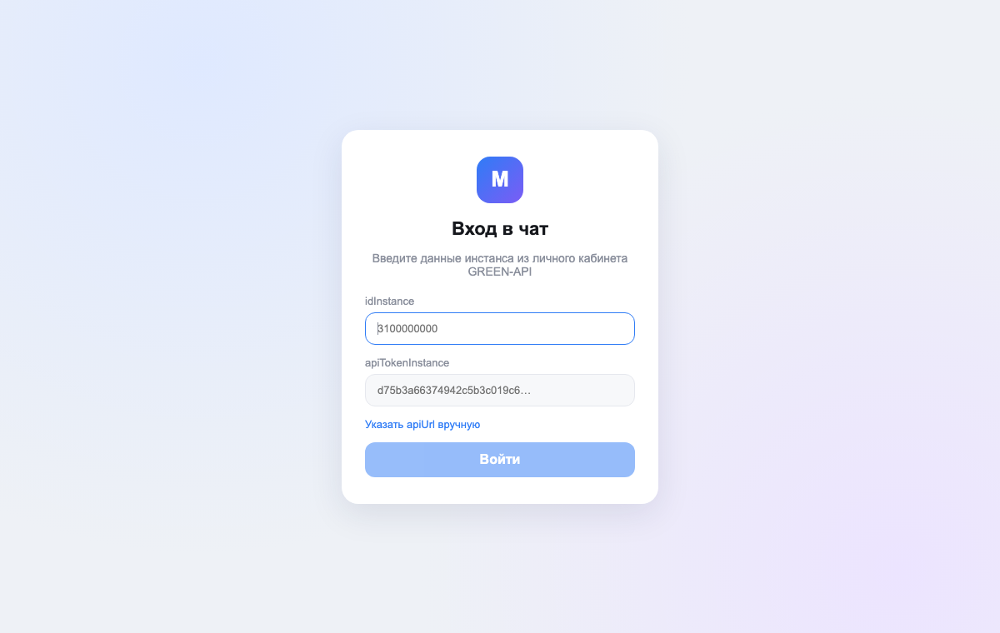

# MAX Web Chat · GREEN-API


A browser chat client for the **MAX** messenger, built on top of [GREEN-API](https://green-api.com/max).
A business can message customers in MAX from a laptop, without a phone. The layout follows
web.max.ru: chat list on the left, conversation on the right. Works on desktop and mobile.

**Live demo:** https://miras05.github.io/max-web-chat/ (requires a GREEN-API instance with MAX
connected)



**Stack:** React 18 + TypeScript (strict) + Vite. No UI libraries and no backend: the app talks to
GREEN-API directly from the browser.

## How it works

| Task | GREEN-API method |
| --- | --- |
| Validate credentials on login | `getStateInstance`: only an `authorized` instance gets in |
| Start a chat by phone number | `checkAccount`: resolves the MAX `chatId` |
| Send | [`sendMessage`](https://green-api.com/v3/docs/api/sending/SendMessage/) |
| Receive | [HTTP API](https://green-api.com/v3/docs/api/receiving/technology-http-api/): `receiveNotification` long-polling loop (5 s) → handle → `deleteNotification` |

Details worth noting:

- **chatId, not the phone number.** MAX recommends sending to the `chatId` returned by
  `checkAccount`, because incoming notifications carry it rather than the number. If
  `checkAccount` is unavailable (e.g. rate limit), the chat is created as `number@c.us` and
  switched to the real `chatId` on the first reply.
- **The queue never gets stuck.** The notification queue is FIFO, so *every* notification is
  deleted, including ones the app ignores (instance status, media). Otherwise new messages would
  never arrive.
- **No duplicates.** The `outgoingAPIMessageReceived` webhook can arrive before the `sendMessage`
  response; messages are reconciled by `idMessage`.
- **Delivery ticks:** ✓ sent, ✓✓ delivered, blue ✓✓ read. A status never moves backwards when
  notifications arrive out of order.
- **Resilience:** on network errors polling continues with growing backoff (up to 15 s), and the
  connection state is shown in the header.
- **New contacts who write first** get a chat created automatically.
- History and credentials are kept in `localStorage`, separately per instance. "Log out" removes
  the credentials.

All of this logic lives in a pure reducer (`src/store.ts`) and is covered by unit tests.

## Run locally

Requires Node.js 18+.

```bash
npm install
npm run dev        # http://localhost:5173
npm test           # unit tests (Vitest)
npm run build      # production build into dist/
```

Log in with `idInstance` and `apiTokenInstance` from the [GREEN-API console](https://console.green-api.com).
`apiUrl` is derived from the first four digits of `idInstance` (`3100…` →
`https://3100.api.green-api.com`) and can be overridden. In the instance settings, `webhookUrl`
must be empty and "Receive notifications about incoming messages and files" enabled, otherwise
`receiveNotification` returns an error.

## Layout

```
src/
├── api/greenApi.ts            # thin GREEN-API client
├── store.ts                   # notification parsing + chat state reducer
├── hooks/useNotifications.ts  # receive loop (HTTP API long polling)
├── components/                # Login, Sidebar, ChatWindow, Avatar
├── utils/format.ts            # phone numbers, time, initials
└── App.tsx
```

## Deployment

The build is static (`base: './'`). Every push to `main` deploys it to GitHub Pages via
`.github/workflows/pages.yml`.

## Limitations

- GREEN-API for MAX only accepts Russian and Belarusian numbers.
- With no backend, the instance token lives in the browser. In production, requests should be
  proxied through a server.
- Two open tabs compete for the same notification queue.

The UI is in Russian, as MAX is used in Russia and Belarus.
